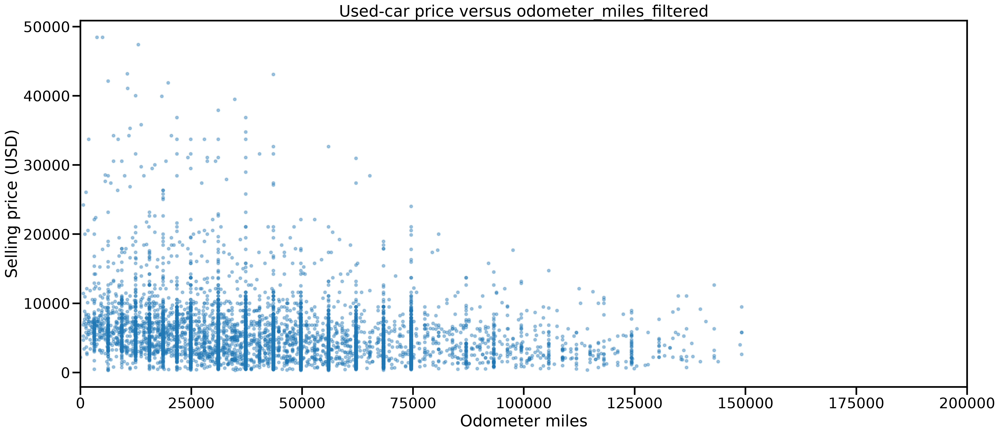
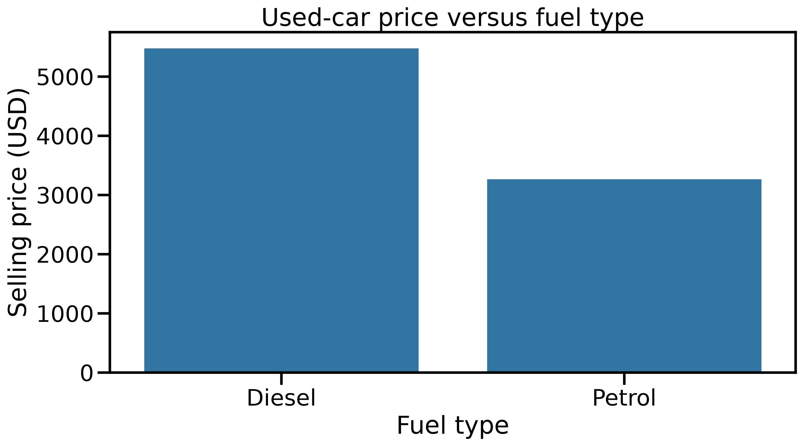
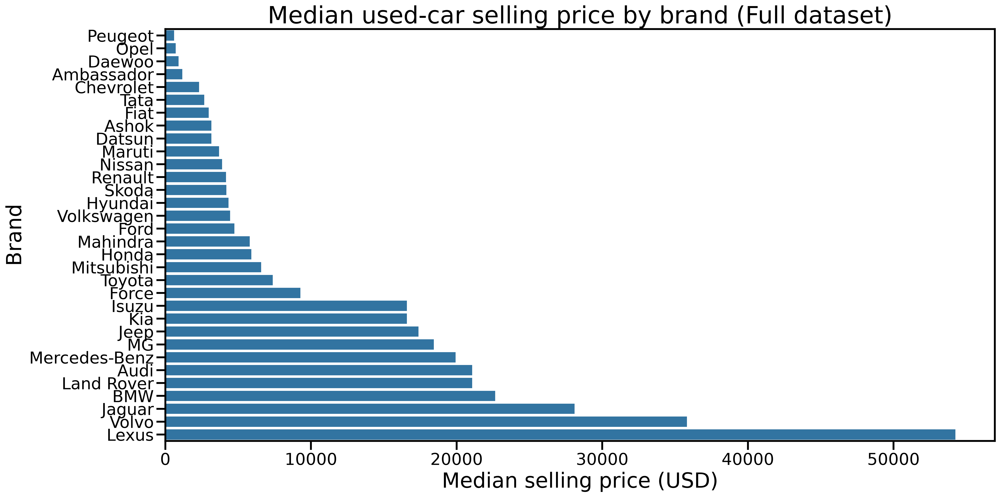
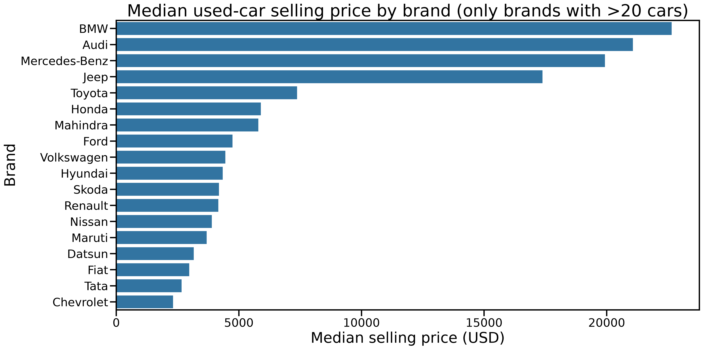

Used-Car Price Analysis

Overview

Many factors influence the price of a used car, so listings can differ a lot. I used Python to see how selling price connects to engine power, distance driven, fuel type, and brand. I also checked how the number of listings for each brand affects our conclusions.

Dataset and Methods

The dataset has selling price, model year, odometer readings, fuel type, and vehicle details. I began with 8,128 rows and removed 1,202 exact duplicates, so 6,926 records remained. Used-car dataset on Kaggle

I used pandas to clean and group the data, and Matplotlib and Seaborn for the charts. I pulled the brand from each vehicle name and changed odometer readings from kilometers to miles. I treated the prices as Indian rupees and converted them to US dollars at a fixed rate of 94.94 INR per USD. Wise historical exchange rate, October 31, 2026

I kept records with missing details for comparisons that didn’t need those fields. (See final project notebook for more detail)  I grouped listings by fuel type and brand to find median prices and counts, then sorted the brand medians. I also filtered the data to see results within a smaller price and mileage range and among brands with more listings and distance driven.

Cars with more engine power usually sold for higher prices. The correlation was about +0.69, but prices still varied a lot among cars with similar horsepower.

Distance driven showed a weak negative link with selling price. The correlation was −0.166 for the whole dataset and −0.225 for cars priced at $50,000 or less with 150,000 miles or less. The negative link got a bit stronger within those limits, but it was still weak.

Diesel versus petrol

The median selling price was $5,477 for diesel cars (3,755 listings) and $3,265 for petrol cars (3,077 listings), a difference of about $2,212. I used medians to avoid the effect of very expensive listings. The two groups might also differ in brand, model year, and distance driven.

Brand prices and sample size

Lexus had the highest median price in the full dataset, but that was based on just one listing. I also compared brands with more than 20 listings so the medians in the second chart would rely less on single cars. Power had a stronger linear relationship with price than odometer mileage did in these listings. The fuel and brand comparisons showed why it matters which cars are in each group and how many listings each group contains.

Limitations

The dataset doesn’t give enough data to draw the conclusions I wanted. The dataset doesn’t include exact listing locations, so I couldn’t compare prices by region or see how well the listings reflect the wider market. Some brands had only a few records, making it hard to estimate a typical price for those brands. Engine power, brand, model year, and mileage can also change together, so these comparisons can’t show how much each factor affects price on its own. If I did this project again, I’d start with a more focused question. For example, how much do diesel and petrol prices differ when the cars are otherwise similar? Before picking a dataset, I’d check if it had enough diesel and petrol listings for the same models, years, and mileage ranges. I’d also look at the counts for each brand. A dataset can have thousands of rows but still not enough examples for the comparison I want.

I’d look for a source that shows where and when each listing was collected, what currency it uses, and whether the price was an asking price or a completed sale. Location and date would let me compare cars in the same market and time. A listing ID would help me tell a repeated listing from a different car with the same details.

With that data, I’d compare median prices within groups of similar cars and say how many listings were in each comparison. If the diesel price gap stayed the same across different models and regions, I’d have stronger proof that it goes beyond this group of cars. If it got smaller or changed a lot, I’d know the overall median was hiding differences between groups.

How to Run

Open Final Project - Copy.ipynb in VS Code, Jupyter, or Google Colab. Save the dataset as cars.csv next to the notebook for a local run, or upload it to the current session in Colab. The notebook uses pandas, Matplotlib, and Seaborn. Run the cells from top to bottom.

 Note: Grammarly was used to consolidate and convey ideas more clearly 